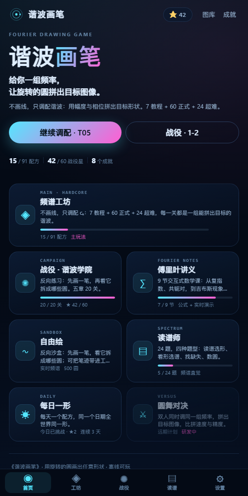

<div align="center">


# 谐波画笔

**给你一组频率，让旋转的圆拼出目标图像。**

一个以「频谱 → 目标图像」为主玩法的傅里叶绘图游戏：拿到目标形状和它的频谱，调幅度、相位与频率 k，把图像一圆圆拼回来。

[网页版](https://harmonic-brush.pages.dev/) · [Android APK](HarmonicBrush-1.0.0-debug.apk) · [Windows 便携版](https://github.com/yhl4466/HarmonicBrush/releases) · [更新说明](#更新与存档)

</div>



## 这是什么

大多数「傅里叶画图」是**先画一笔，再看它被拆成哪些圆**。谐波画笔反过来：

- **出频谱 → 拼目标图像**：工坊给你目标与它的频谱，你只调配谐波。
- **反向练习**：战役与自由绘保留「先画一笔，再看它拆成哪些圆」，用来建立直觉。
- **读谱练习**：看频谱选形状、找缺失谐波、数圆，训练读谱能力。

核心只有一条公式：

$$
p(t)=\sum_k c_k e^{2\pi i k t}
$$

每个圆是一个频率分量：半径是幅度，转速是频率 k，转角是相位。

## 玩法

1. 选一关，看到目标形状与目标频谱。
2. 在底部「添加」里选 k，拖动幅度/相位，直到误差够小。
3. 结算拿星：误差 ≤ 阈值，且不超预算。

手机竖屏：画布占主区，频谱面板是可收起的底部抽屉（频谱 / 系数 / 添加）；横屏自动左右分栏。

## 内容

| 模式 | 数量 | 说明 |
| --- | --- | --- |
| **频谱工坊** | 91 关 | 7 教程 + 60 正式（6 章 × 10）+ 24 超难；主玩法 |
| 反向战役 | 20 关 | 先描一笔，再看它拆成哪些圆 |
| 读谱师 | 24 题 | 看形选谱 / 找缺失 / 数圆 / 频谱直觉 |
| 每日一形 | 每天 1 题 | 日期种子生成，连续天数 |
| 傅里叶讲义 | 9 节 | 合成 → 旋转的圆 → 椭圆 → DC → 尖角 → 吉布斯 → 采样 |
| 图库 / 成就 | 91 + 20 / 24 | 最佳成绩与数学里程碑 |

还有外观（3 主题 / 3 画笔 / 2 尾迹，按工坊进度解锁）、自由沙盒（把笔迹带进工坊）、每日结果卡与离线存档。

## 下载

- **网页版（推荐，无需安装）**：<https://harmonic-brush.pages.dev/>
- **Android**：下载 [`HarmonicBrush-1.0.0-debug.apk`](HarmonicBrush-1.0.0-debug.apk)，允许未知来源安装；debug 签名，覆盖安装会保留存档。
- **Windows**：在 [Releases](https://github.com/yhl4466/HarmonicBrush/releases) 下载便携 exe，双击即用，不依赖 Node/Edge/网络。

> 国内访问 GitHub 不稳定时用 Cloudflare Pages 主站；GitHub Pages 作为备用，详见 [DEPLOY.md](DEPLOY.md)。

## 更新与存档

- 设置 → **版本与更新**：检查更新、更新说明、下载新版；更新源可在设置里改。
- 设置 → **存档**：导出 JSON、导入、恢复自动备份；启动 / 导入 / 清除前都会留底。
- 覆盖安装或更新不会清空进度；`version.json` 是更新清单。

## 技术

- 纯前端：原生 JS + Canvas 2D，无框架、无构建依赖，`file://` 也能跑。
- 数学：N=1024 等弧长重采样 → radix-2 FFT → 重建；战役用归一化 Chamfer 误差，工坊用参数无关的几何距离。
- 关卡：确定性种子生成 60 + 24 关，`generator.js` 可复现；读谱 16 道程序题。
- 多端：Electron 便携 exe；Capacitor Android（`android/`，debug APK）。
- 测试：`node tests/test-core.cjs`、`tests/calibrate.cjs`、`tests/test-generator.cjs`；游戏内自检 94 项。

## 目录

```
index.html          游戏入口（多文件 script，file:// 可用）
src/                app / core / data / render / shapes / ui / play / workshop / lessons / generator / formula / styles
assets/             图标与启动图
screenshots/        README 截图
version.json        更新清单
download.html       下载页
DEPLOY.md           部署与镜像说明
```

## 许可

MIT。图标与截图随项目一起提供。
